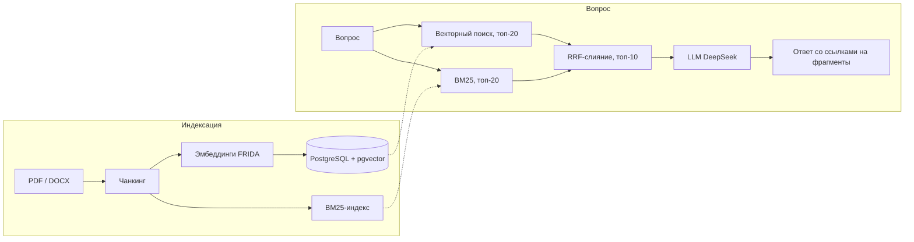

# RAG-система для анализа судебных документов

Сервис отвечает на вопросы по папке судебных документов (PDF, DOCX). Он находит подходящие фрагменты гибридным поиском (векторы + BM25), передаёт их LLM и возвращает ответ со ссылками на источники. На каждом шаге видно, какие фрагменты нашлись, какие попали в топ и на какие сослалась модель, а также сколько времени и денег ушло на запрос.

## Возможности

- **Индексация документов:** PDF и DOCX, рекурсивный чанкинг по токенам модели эмбеддингов. Стратегии чанкинга подключаются как отдельные функции и сравниваются между собой.
- **Гибридный поиск:** векторный поиск в PostgreSQL (pgvector, косинусное расстояние) и BM25 с русским стеммингом, результаты сливаются через Reciprocal Rank Fusion.
- **Прозрачность:** веб-интерфейс показывает всех кандидатов, их ранги в обоих поисках, итоговый топ-10 и фрагменты, процитированные в ответе.
- **Учёт затрат:** время каждого этапа, токены и стоимость запроса (с учётом кэша и пиковых часов тарифа) пишутся в PostgreSQL и в лог.
- **Локальные эмбеддинги:** модель FRIDA (SberDevices) работает внутри контейнера, документы не отправляются во внешние сервисы эмбеддингов.

## Технологии

| Область | Стек |
|---|---|
| Backend | Python 3.12, FastAPI (async), Pydantic Settings |
| Данные | PostgreSQL 17 + pgvector, SQLAlchemy 2 (async) + asyncpg |
| RAG | LangChain: загрузчики документов, `RecursiveCharacterTextSplitter`, `BM25Retriever`, `HuggingFaceEmbeddings`, `ChatDeepSeek` |
| Модели | эмбеддинги `ai-forever/FRIDA` (sentence-transformers), LLM DeepSeek API |
| Поиск | pgvector (cosine), BM25 (rank-bm25 + snowball-стеммер), Reciprocal Rank Fusion |
| Логирование | Loguru |
| Инфраструктура | Docker, Docker Compose |
| Интерфейс | HTML + JavaScript без фреймворков, Swagger UI |

## Как это работает



## Структура проекта

```
app/
├── main.py              # создание FastAPI-приложения, загрузка модели и BM25-индексов при старте
├── schemas.py           # Pydantic-схемы запросов и ответов
├── api/routes.py        # эндпоинты /api/index, /api/ask, /api/stats, /api/strategies
├── core/
│   ├── config.py        # настройки: модели, размеры чанков, параметры поиска, цены
│   └── logging.py       # настройка Loguru
├── db/
│   ├── models.py        # таблицы chunks (текст + вектор) и queries (журнал запросов)
│   └── session.py       # async-подключение к PostgreSQL
├── repositories/        # SQL-запросы: сохранение и поиск чанков, статистика
├── services/
│   ├── loader.py        # чтение PDF и DOCX
│   ├── chunking.py      # стратегии чанкинга
│   ├── embeddings.py    # модель эмбеддингов
│   ├── bm25.py          # BM25-индексы с русским стеммингом
│   ├── retrieval.py     # гибридный поиск и RRF
│   ├── llm.py           # вызов LLM, подсчёт токенов и стоимости
│   ├── indexing.py      # пайплайн индексации
│   ├── rag.py           # пайплайн ответа на вопрос
│   └── timing.py        # замер времени этапов
└── static/index.html    # веб-интерфейс
docker-compose.yml       # PostgreSQL + приложение
Dockerfile
requirements.txt
```

## Запуск

```bash
cp .env.example .env        # указать ключ DeepSeek в ai_key
mkdir -p data               # положить сюда документы .pdf и .docx
docker compose up -d --build
```

Интерфейс: http://127.0.0.1:8000, документация API: http://127.0.0.1:8000/docs.

При первом запуске модель FRIDA (≈3,3 ГБ) скачивается с Hugging Face в `~/.cache/huggingface`.
